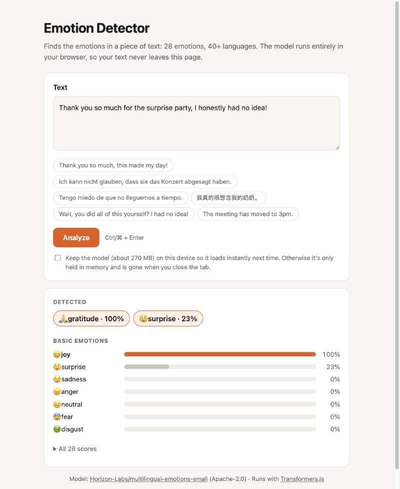

# Emotion Detector

Find the emotions in any piece of text, in 40+ languages, with an AI model that runs entirely in your browser. No server, no API key, and your text never leaves the page.

**[▶ Try the live demo on Hugging Face Spaces](https://huggingface.co/spaces/GHeart01/emotion-detector)**



## Features

- **28 emotions**, from admiration to surprise (the [GoEmotions](https://huggingface.co/datasets/google-research-datasets/go_emotions) label set), with a text able to show several at once.
- **40+ languages**, including English, Spanish, German, Chinese, Arabic and Hindi.
- **Three views of the result:** the emotions detected above each label's tuned threshold, a summary of 7 basic emotions, and all 28 raw scores.
- **Private by design:** the model runs locally in the browser with [Transformers.js](https://huggingface.co/docs/transformers.js), and nothing is stored on the visitor's device unless they choose to keep it.
- **No build step:** plain HTML, CSS and JavaScript. Any static file host can serve it.

## Quick start

Run it locally with any static file server. You need one because browsers block ES modules on `file://` pages.

```bash
git clone https://github.com/GHeart01/emotion-detector.git
cd emotion-detector
python3 -m http.server 8000
```

Open <http://localhost:8000>. The model (about 270 MB) downloads on first load and is ready in a few seconds on a fast connection.

## How it works

1. When the page opens, [`app.js`](../app.js) loads Transformers.js from a CDN and starts downloading [Horizon-Labs/multilingual-emotions-small](https://huggingface.co/Horizon-Labs/multilingual-emotions-small), using its 8-bit quantized ONNX weights.
2. It also fetches two small files from the model repo:
   - `thresholds.json`: one decision threshold per emotion, tuned by the model's authors. This works much better than a flat 0.5 for rare emotions like grief or relief.
   - `ekman_mapping.json`: groups the 28 emotions into 6 basic ones (anger, disgust, fear, joy, sadness, surprise). The app adds neutral as a seventh.
3. When you click **Analyze**, the model scores each of the 28 emotions independently (it's a multi-label model). Every emotion above its threshold shows as **Detected**. If none clears its threshold, the app shows the top one.

### Storage and privacy

The model is large, so the app avoids leaving it on people's devices by default:

| | What happens |
|---|---|
| **Default** | The model downloads with caching turned off and lives only in the tab's memory. Closing the tab removes it completely. |
| **"Keep the model" ticked** | The model is saved with the browser's Cache API, and later visits load it from the device. If the visitor ticks the box after the model has loaded, it downloads once more to save it. |
| **"Remove it" clicked** | The saved copy is deleted. The model stays in memory until the tab closes. |
| **Saving fails** | Browsers may refuse to store a file this large. The app detects this, deletes any partial copy, and tells the visitor. |

Analysis always happens locally. The only network requests are for the model files, the Transformers.js library and its WebAssembly runtime.

## Deploy your own copy

The app is set up as a free **static** [Hugging Face Space](https://huggingface.co/docs/hub/spaces). With the [`hf` CLI](https://huggingface.co/docs/huggingface_hub/guides/cli) installed and logged in (`hf auth login`), run this from the repo folder, replacing `<username>`:

```bash
hf repos create <username>/emotion-detector --type space --sdk static
```
```bash
hf upload <username>/emotion-detector . --type space --exclude ".git/*" --exclude ".github/*"
```

The root [`README.md`](../README.md) holds the Space's settings (title, emoji, SDK) in its front matter, so keep that file. This page lives in `.github/README.md` so that GitHub shows it instead.

The app works on any other static host too, such as GitHub Pages, Netlify or Cloudflare Pages. Just serve the folder.

## Configuration

Everything is in [`app.js`](../app.js):

| Setting | What it does |
|---|---|
| `MODEL` | The Hugging Face model to load. It must be a text-classification model with ONNX weights that Transformers.js supports. Look for the `transformers.js` tag on the Hub. |
| `dtype: "q8"` | Which weights to download. `q8` (8-bit, about 270 MB) is the smallest this model offers. `fp32` is about 560 MB. |
| `EXAMPLES` | The example sentences shown under the text box. |
| `EMOJI` | The emoji shown next to each emotion label. |
| Import URL | Transformers.js is pinned to `@4.3.2`. Change the version in the `import` line to upgrade. |

If you switch to a model that has no `thresholds.json` or `ekman_mapping.json`, the app falls back to a 0.5 threshold and the basic-emotions panel shows only neutral.

## Project structure

```
├── index.html          Page layout
├── app.js              Model loading, storage, inference and rendering
├── style.css           Styles, with automatic light and dark mode
├── README.md           Hugging Face Space settings and description
└── .github/
    ├── README.md       This file (shown on GitHub)
    └── screenshot.jpg
```

## Limitations

- **First load is heavy:** about 270 MB per visit unless the visitor saves the model. On mobile data that is slow and may cost money.
- **Saved copies can disappear:** browsers can evict cached data when disk space is low, and Safari deletes it after 7 days without a visit.
- **Accuracy:** the model was trained mostly on Reddit comments plus machine translations. Short, sarcastic or highly contextual text can be misread. See the [model card](https://huggingface.co/Horizon-Labs/multilingual-emotions-small) for benchmark results.
- **Browser support:** it needs a modern browser with WebAssembly. It has been tested in Chromium-based browsers.

## Contributing

Issues and pull requests are welcome. There's no build or test tooling, so to try a change:

1. Run the local server from [Quick start](#quick-start).
2. Check the default flow: the model loads, the examples give sensible results, and the browser console shows no errors.
3. If you changed anything related to storage, also check that ticking **Keep**, reloading, and clicking **Remove it** still work. Use DevTools → Application → Cache Storage to see what's stored.

## Credits

- Model: [Horizon-Labs/multilingual-emotions-small](https://huggingface.co/Horizon-Labs/multilingual-emotions-small) (Apache-2.0), based on [jhu-clsp/mmBERT-small](https://huggingface.co/jhu-clsp/mmBERT-small)
- Runtime: [Transformers.js](https://github.com/huggingface/transformers.js) by Hugging Face
- Emotion labels: [GoEmotions](https://huggingface.co/datasets/google-research-datasets/go_emotions) by Google Research
